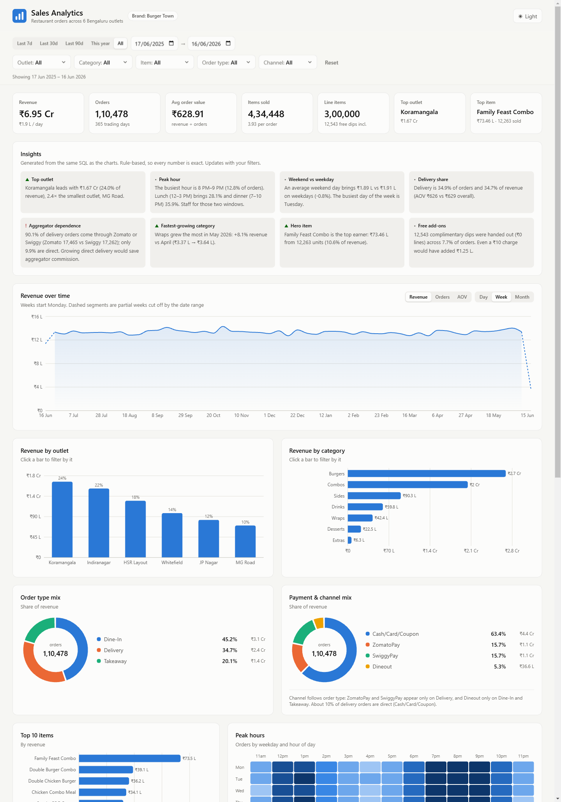
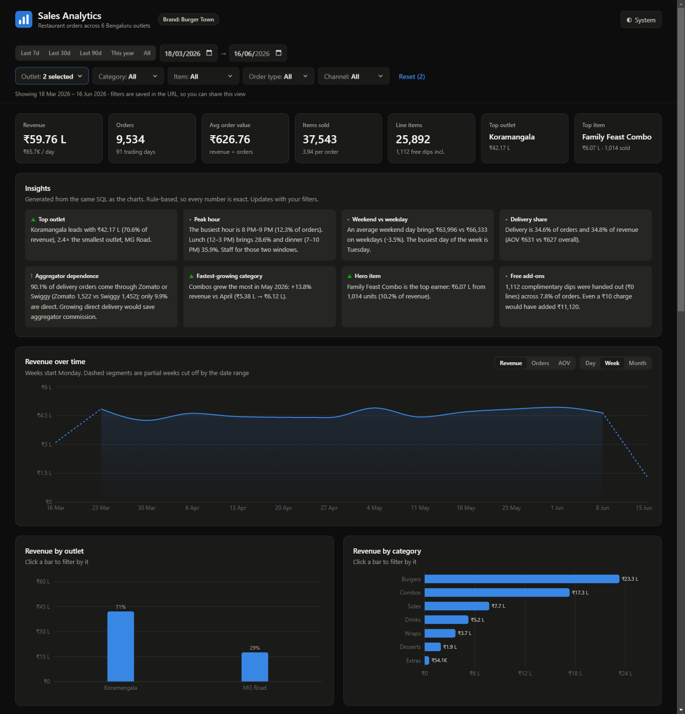
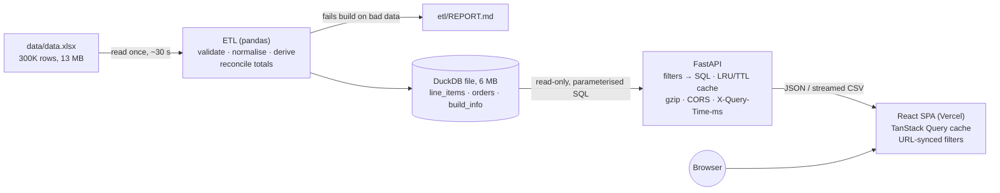

# Sales Analytics Dashboard

A fast, filterable analytics dashboard over **300,000 restaurant line items**
(110,478 orders, ₹6.95 Cr revenue, one year, six outlets). A validated ETL
turns the raw Excel export into an embedded **DuckDB** database. A read-only
**FastAPI** service answers every chart in single-digit to low-double-digit
milliseconds, and a **React + Recharts** frontend presents it with
URL-shareable filters.

| | |
|---|---|
| **Live dashboard** | **https://sales-analytics-dashboard.vercel.app** <!-- LIVE_FRONTEND --> |
| **API** (OpenAPI docs at `/docs`) | **https://sales-analytics-api.onrender.com** <!-- LIVE_API --> |
| **Decision log** | [`DECISIONS.md`](DECISIONS.md): every trade-off with the measurements behind it |
| **Data validation report** | [`etl/REPORT.md`](etl/REPORT.md): generated by the ETL |

> The API runs on Render's free tier, which sleeps after ~15 minutes idle. The
> first visit can take **30–60 s** while it boots. The dashboard shows a
> "waking up the server" screen instead of hanging, and is instant afterwards.



<details>
<summary>Dark theme with filters applied (2 outlets, last 90 days)</summary>


</details>

---

## Contents

1. [What it does](#what-it-does)
2. [Tech stack](#tech-stack)
3. [Run it locally](#run-it-locally)
4. [Architecture and decisions](#architecture-and-decisions)
5. [Understanding the data](#understanding-the-data)
6. [Performance (measured)](#performance-measured)
7. [API reference](#api-reference)
8. [Testing and CI](#testing-and-ci)
9. [Trade-offs and what I'd do with more time](#trade-offs-and-what-id-do-with-more-time)
10. [Project structure](#project-structure)

---

## What it does

- **KPIs:** revenue, orders, average order value (AOV), items sold, avg items
  per order, line-item count, top outlet and top item. All of them respond to
  every filter.
- **Charts:**
  - Revenue / orders / AOV over time (day / week / month), with partial
    periods marked.
  - Revenue by outlet (bar) and by category (horizontal bar).
  - Order-type mix and payment/channel mix (donuts).
  - Top 10 items.
  - Weekday × hour **peak-hours heatmap**.
- **Filters:**
  - Date range with presets (last 7/30/90 days, this year, all) plus custom dates.
  - Multi-selects for outlet ("region"), category, item (searchable), order
    type and payment channel, with one-click reset.
  - Filters are **synced to the URL**, so any view can be shared or bookmarked.
  - Clicking a bar cross-filters by that outlet, category or item.
- **Insights panel:** eight plain-English findings computed in SQL for the
  current filters, e.g. *"90.1% of delivery orders come through Zomato or
  Swiggy; only 9.9% are direct"*.
- **Records table:** server-side paginated and sortable raw line items, with a
  streamed **CSV export** of everything matching the filters.
- **UX details:**
  - Loading skeletons, plus empty and error states with retry.
  - Refetches keep the previous chart dimmed instead of flashing.
  - INR formatting with lakh/crore (₹6.95 Cr, 1,10,478).
  - Light/dark theme, responsive down to 360 px.
  - The footer shows the live server time of the last API call.

## Tech stack

| Layer | Choice | Why |
|---|---|---|
| ETL | Python, **pandas**, openpyxl | Reads the xlsx once, validates, derives columns, reconciles totals |
| Database | **DuckDB** (embedded, read-only file, 6 MB) | Columnar engine for `GROUP BY`/`COUNT DISTINCT` workloads; 5–30× faster than SQLite here ([D4](DECISIONS.md#d4-sqlite--duckdb-for-the-serving-database-measured)) |
| API | **FastAPI** + Uvicorn | Typed query validation, OpenAPI docs, threadpool for sync DB calls |
| Caching | In-process LRU+TTL, startup warm-up, `Cache-Control`, TanStack Query | Repeat views in ~1 ms; no extra infrastructure |
| Frontend | **React 19 + TypeScript + Vite** | Fast builds, typed API contract |
| Styling | **Tailwind CSS v4** with CSS-variable design tokens | Light/dark themes from one token set |
| Charts | **Recharts** (+ a CSS-grid heatmap) | Declarative, responsive SVG charts |
| Data fetching | **TanStack Query** | Request dedupe, client cache, keep-previous-data on filter changes |
| Hosting | **Render** (API, Docker) + **Vercel** (static frontend) | Free tiers; Docker image also runs anywhere |
| CI | GitHub Actions | ETL + pytest, lint + type-check + build on every push |

## Run it locally

**Prerequisites:** Python 3.11+ and Node 20+ (or just Docker for the API).

```bash
git clone https://github.com/aboro-code/sales-analytics-dashboard.git
cd sales-analytics-dashboard
```

**1. ETL: build the database (~30–60 s, mostly reading the xlsx)**

```bash
python -m venv .venv
# macOS/Linux: source .venv/bin/activate     Windows: .venv\Scripts\activate
pip install -r backend/requirements-dev.txt   # API + ETL + test deps
python etl/build_db.py                        # data/data.xlsx -> data/sales.duckdb, writes etl/REPORT.md
```

**2. Backend: http://127.0.0.1:8000 (interactive docs at `/docs`)**

```bash
cd backend
uvicorn app.main:app --reload --port 8000
```

**3. Frontend: http://localhost:5173**

```bash
cd frontend
npm install
npm run dev        # Vite proxies /api to :8000, so no env var is needed locally
```

**Tests, benchmark and production build:**

```bash
cd backend && python -m pytest                              # 46 tests
python backend/scripts/bench.py http://127.0.0.1:8000        # latency benchmark (API must be running)
cd frontend && npm run lint && npm run build                 # oxlint, tsc, vite build
```

**Or run the API with Docker** (the image builds the database itself):

```bash
docker build -f backend/Dockerfile -t sales-api .
docker run -p 8000:8000 sales-api
```

| Env var | Where | Default | Purpose |
|---|---|---|---|
| `VITE_API_URL` | frontend (build time) | empty (dev proxy) | Base URL of the API |
| `ALLOWED_ORIGINS` | API | `http://localhost:5173,...` | Exact CORS origins |
| `ALLOWED_ORIGIN_REGEX` | API | none | CORS origin pattern (Vercel prod + previews) |
| `SALES_DB_PATH` | API | `data/sales.duckdb` | Database location |
| `CACHE_TTL_SECONDS` / `CACHE_MAXSIZE` | API | `3600` / `512` | Response cache |
| `DUCKDB_MEMORY_LIMIT` / `DUCKDB_THREADS` | API | `256MB` / auto | Fit small instances |
| `WARM_CACHE` | API | `1` | Pre-compute the default dashboard at startup |

## Architecture and decisions



The full reasoning, with numbers, is in [`DECISIONS.md`](DECISIONS.md). The short version:

### 1. Why an ETL step, rather than reading the file directly

Parsing `data.xlsx` with pandas/openpyxl takes **21–44 s** on a laptop. Reading
it per request is out of the question, and even once per cold start on a
free-tier container would add most of a minute to every wake-up. Instead the
ETL runs **once, at build time** (in CI and in the Docker build stage):

1. **Extract:** read the xlsx (or a CSV).
2. **Validate.**
   - *Hard checks* fail the build and the deploy: schema, nulls, duplicates,
     unparseable dates, non-numeric values, negative prices, items in more than
     one category, and **bill-level consistency** (outlet, order type,
     settlement and timestamp must be identical on every line of a bill).
   - *Soft checks* are reported only: one price per item, and Price = 0 rows.
3. **Normalise and derive.**
   - Trim and collapse whitespace.
   - Parse datetimes, accepting both real Excel datetimes and `DD-MM-YYYY`
     strings, `dayfirst=True`.
   - Add `revenue = price × quantity`, `order_date`, ISO `week` (Monday),
     `month`, `hour` and `weekday`.
4. **Model:** a `line_items` fact table plus an `orders` table (one row per
   bill, with `order_value` and `item_count` pre-aggregated). Rows are
   physically sorted by timestamp, so DuckDB's per-row-group min/max zone maps
   prune date-range filters without secondary indexes.
5. **Reconcile:** row count, order count and revenue in the database must
   equal what pandas computed (₹69,480,952 both ways).
6. **Atomic swap:** write to `*.tmp`, then rename, so the API never opens a
   half-written file.

### 2. Why a database at all, and why DuckDB

- **In-memory pandas in the API** was rejected. Every request would hold
  ~100 MB of DataFrames in a 512 MB free-tier box, and each filter combination
  would re-scan in Python. It also couples the API to pandas.
- **PostgreSQL** is the right answer for multi-writer, concurrent, growing
  data. For a read-only, 300K-row, single-file dataset it adds a server, a
  connection pool, a migration step and a second paid or free-tier service, for
  no gain.
- **SQLite was my first implementation.** It's committed in the history, with
  covering indexes, `immutable=1` and mmap. **Measured** on the real data:
  unfiltered `/api/summary` took ~240 ms and the group breakdown ~440 ms.
  SQLite is row-oriented, and these queries are scan + `GROUP BY` +
  `COUNT(DISTINCT)`.
- **DuckDB** is still embedded (one file, no server, opened read-only) but
  columnar and vectorised. The same queries run in **3–37 ms** and the file
  shrinks from **101 MB to 6 MB**. The one regression is deep `OFFSET`
  pagination; keyset pagination fixes that if it ever matters.

### 3. How filters become SQL, and how group/item filters work

Every data endpoint accepts the same filters:
`start, end, outlets, groups, items, order_types, settlements`.

- **Validation:** values are checked against the real dimension values, so an
  unknown outlet is a `422` with a clear message, not an empty chart. All SQL
  uses `?` placeholders, and sort columns come from a whitelist.
- **Order-level vs line-level filters:** outlet, order type, settlement and
  date are constant within a bill, so they are order-level. Category and item
  vary within a bill, so they are line-level.
- **One code path for both:** every order-level query reads from a single CTE
  `o`.
  - With no category/item filter, `o` is the pre-aggregated `orders` table
    (the fast path).
  - With one, `o` is the matching line items grouped by bill.
- **Effect on metrics:** with `groups=Drinks`, *orders* = bills containing a
  drink, *revenue* = drink lines only, and *AOV* = average drink spend per
  order that had a drink. A test checks that per-category revenues sum exactly
  to the total.

### 4. Caching strategy

| Layer | What | Effect |
|---|---|---|
| Startup warm-up | Default dashboard (all endpoints, no filters) computed in a background thread | First visitor after a cold start gets cache hits |
| API response cache | LRU (512) + TTL (1 h), key = endpoint + **normalised** filters | Repeat views ~1 ms; `X-Cache: HIT/MISS` header |
| HTTP | `Cache-Control: public, max-age=300`, gzip | Browser reuse; JSON 5.6–15.5× smaller (measured) |
| Client | TanStack Query (dedupe, 5 min stale time, keep previous data) | No duplicate requests; no flicker on filter changes |
| Input | 300 ms debounce on filter changes | Rapid multi-select clicks become one request burst |

The data is immutable for the life of a build, so the cache can never serve
stale data within a deploy. A redeploy (new ETL) starts with a fresh process
and a fresh cache.

### 5. Frontend decisions

- **Server-side everything:** aggregation, pagination, sorting and CSV
  generation. The browser never holds more than one page of rows, and the
  export streams in 5,000-row batches with constant memory.
- **One measure per axis:**
  - Revenue and orders differ by ~600×, so the trend chart toggles between
    them rather than using a misleading dual axis.
  - Partial weeks/months (the data ends on a Tuesday) are drawn dashed and
    labelled, not shown as a sales crash.
- **Colour follows the entity:** order types and channels keep their colour
  when filtered. The palette was checked with a colour-vision-deficiency
  validator for light and dark themes.
- **Date presets anchor to the last date in the data**, not today. Otherwise
  "last 30 days" would be empty.

## Understanding the data

Profiled by the ETL (full table in [`etl/REPORT.md`](etl/REPORT.md)):

| Fact | Value |
|---|---|
| Rows (line items) / orders (unique `BillNo`) | 300,000 / 110,478 (≈2.7 lines per order) |
| Date range | 17 Jun 2025 11:02 → 16 Jun 2026 23:48 (365 trading days) |
| Trading hours | 11:00–23:59, peaks at lunch (12–3 PM, 28%) and dinner (7–10 PM, 36%) |
| Nulls / duplicate rows | 0 / 0 |
| Bills with inconsistent outlet/type/settlement/time | 0, so order-level metrics are safe |
| Outlets ("region") | Koramangala, Indiranagar, HSR Layout, Whitefield, JP Nagar, MG Road |
| Categories / items | 7 categories (Burgers … Desserts), 45 items, **each with exactly one price** |
| Order types | Dine-In 45% · Delivery 35% · Takeaway 20% (of revenue) |
| Settlement | Cash/Card/Coupon 63% · ZomatoPay 16% · SwiggyPay 16% · Dineout 5% |
| Price / quantity | ₹0–₹599 / 1–4 |
| Total revenue / AOV | **₹69,480,952 (₹6.95 Cr) / ₹628.91** |

**Channel insight:**

- ZomatoPay and SwiggyPay appear **only** on Delivery, and Dineout only on
  Dine-In and Takeaway. So *Settlement* is really "payment *and* channel".
- Delivery also has 10,184 direct Cash/Card/Coupon lines, so aggregators
  carry ~90% of delivery orders, not 100%.
- That's a concrete lever: every point moved to direct delivery saves
  aggregator commission.

### Metric definitions

| Metric | Definition |
|---|---|
| Revenue | Σ `price × quantity` over matching line items |
| Orders | Count of distinct `BillNo` with ≥ 1 matching line item |
| AOV | Revenue ÷ Orders |
| Items sold | Σ `quantity` |
| Records / line items | Count of matching rows |
| Avg items per order | Items sold ÷ Orders |
| Share | Category revenue ÷ total revenue *for the same filters* (also when only the top N are returned) |

### Assumptions

1. **₹0 rows are complimentary add-ons, not bad data.** All 8,611 `Price = 0`
   rows are `Dip - BBQ` / `Dip - Mayo` (Extras). They are kept in item counts,
   contribute ₹0 revenue, and are labelled "free" in the table and in an
   insight.
2. **Single brand.** `Brand` is "Burger Town" on every row, so it's shown as a
   header badge and deliberately **not** offered as a filter. A filter with one
   option is noise.
3. **Datetime format.** The brief documents `DD-MM-YYYY HH:MM:SS` strings; the
   file actually stores real Excel datetimes. The parser handles both, parsing
   strings day-first so `03-02-2026` is 3 February. Tests cover both paths.
4. **Times are local (IST)** and used as-is; no timezone conversion.
5. **Outlet = region** for the brief's "region" filter. All six are Bengaluru
   neighbourhoods.
6. **Weeks start on Monday (ISO).** First/last weeks and months that are cut
   off by the data or the filter range are flagged as `partial`.

## Performance (measured)

**ETL** (laptop, Python 3.14): 24–60 s end to end. Reading the xlsx is
**75–80% of it**, which is exactly why it happens once at build time.

| Stage | Time |
|---|---:|
| Read xlsx (openpyxl) | 21–44 s |
| Validate + transform | ~5 s |
| Load DuckDB | < 1 s |

**API latency** (`backend/scripts/bench.py`, 15 runs each, p50, server-side time from `X-Query-Time-ms`, laptop):

| Endpoint | Uncached (DuckDB) | Cached |
|---|---:|---:|
| `/api/summary` | 15 ms | 0.6 ms |
| `/api/summary?groups=Drinks` (line-level filter) | 20 ms | 0.7 ms |
| `/api/timeseries?granularity=week` | 6 ms | 1.5 ms |
| `/api/breakdown?dim=outlet` | 4 ms | 0.7 ms |
| `/api/breakdown?dim=item&limit=10` | 36 ms | 0.8 ms |
| `/api/heatmap` | 5 ms | 1.5 ms |
| `/api/insights` (8 rule-based insights) | 38 ms | 0.8 ms |
| `/api/records` (page 1) | 13 ms | 1.3 ms |
| `/api/export.csv` (all 300K rows, 33 MB, streamed) | 2.7 s | n/a |

For comparison, the same summary/group queries on SQLite were 243 ms and
437 ms ([D4](DECISIONS.md#d4-sqlite--duckdb-for-the-serving-database-measured)).

**Page load** (production build, local API):
- First contentful paint ≈ 0.3 s.
- All 12 initial API calls complete ≈ 160 ms after navigation.
- JS is ~225 KB gzipped, split into app / vendor / charts chunks so the chart
  library caches independently.

**Live deployment** (Render free tier: 0.1 vCPU, Singapore):
- Warm API calls return in a few hundred ms round trip, mostly network.
- The default view is served from the startup-warmed cache.
- Cold start after idling: 30–60 s, covered by the waking screen.

**What makes it fast:**
- **Columnar scans** in DuckDB.
- A **pre-aggregated `orders` table**, so no `GROUP BY bill_no` without a
  line filter.
- **Time-sorted storage** for zone-map pruning on date filters.
- **Projection of only the needed columns.**
- **Response caching with startup warm-up**, and **gzip**.
- **Client-side dedupe and debouncing.**

## API reference

All data endpoints accept the shared filters
`start`, `end` (inclusive `YYYY-MM-DD`), and `outlets`, `groups`, `items`,
`order_types`, `settlements` (repeat the param or comma-separate). Every
response carries `X-Query-Time-ms`; cached endpoints also carry `X-Cache`.
Interactive docs: **`/docs`**.

| Method | Path | Extra params | Returns |
|---|---|---|---|
| GET | `/health` | none | Liveness, row count, build time, cache stats |
| GET | `/api/meta` | none | Filter options (outlets, groups, items with prices, order types, settlements), brand, min/max date, build info |
| GET | `/api/summary` | filters | KPIs: records, orders, revenue, AOV, items sold, avg items/order, free items, active days, avg daily revenue, top outlet, top item |
| GET | `/api/timeseries` | `granularity=day\|week\|month` | Per period: revenue, orders, items, AOV, `days`, `period_days`, `partial` |
| GET | `/api/breakdown` | `dim=outlet\|group\|item\|order_type\|settlement`, `limit` (1–100) | Per category: revenue, orders, quantity, share, revenue per order |
| GET | `/api/heatmap` | filters | Orders and revenue per weekday (0 = Mon) × hour |
| GET | `/api/insights` | filters | Up to 8 `{id, title, text, tone, value}` insights |
| GET | `/api/records` | `page`, `page_size` (≤ 200), `sort`, `order=asc\|desc` | Paginated line items + `total`, `pages` |
| GET | `/api/export.csv` | filters | Streamed CSV of all matching line items |

Example: `GET /api/breakdown?dim=item&limit=5&outlets=Koramangala,MG Road&start=2026-01-01`

## Testing and CI

- **46 pytest tests** (`backend/tests`), running in ~1 s.
  - **ETL:** day-first string parsing vs native datetimes, derived columns,
    and hard failures on inconsistent bills, nulls, bad dates and missing
    columns.
  - **API:** on a hand-computable synthetic dataset built *with the real ETL
    code*. Covers every endpoint, the order-vs-line filter semantics, inclusive
    date ranges, empty results, `422` validation, SQL-injection attempts,
    unknown sort columns, partial periods, pagination, CSV export, cache
    HIT/MISS on reordered params, gzip and CORS.
  - **Real data:** the known totals (300,000 / 110,478 / ₹69,480,952), the
    aggregator-only-on-delivery rule, ₹0 rows being dips, and per-category
    revenues summing to the total.
- **GitHub Actions:** on every push it builds the database (so a bad data file
  fails CI), runs pytest, then lints, type-checks and builds the frontend.

## Trade-offs and what I'd do with more time

| Area | Today | Next step |
|---|---|---|
| Storage | Embedded DuckDB, rebuilt per deploy | **PostgreSQL** (or MotherDuck) once data is written continuously or by several services. Keep DuckDB/Parquet for analytics. |
| Ingestion | Full rebuild from one xlsx | **Incremental ingestion:** append new days to partitioned Parquet, idempotent by `BillNo`, scheduled job, with the same validation gate |
| Scale-out | One instance, in-process cache | Redis or a CDN in front of the read-only GET API; pre-aggregated rollups (day × outlet × channel) if data grows 100× |
| Pagination | `OFFSET` | Keyset pagination for deep pages |
| Auth | Public read-only demo | OAuth/SSO with outlet-level row filtering (a manager sees only their outlets) |
| Insights | Rule-based templates over SQL | An **LLM layer** that rephrases and prioritises the computed facts (never computes numbers), plus anomaly detection (z-scores on daily revenue per outlet) |
| Analytics | Descriptive | Period-over-period deltas on KPIs, basket analysis (items bought together), forecasting |
| Hosting | Free tier with cold starts | A paid always-on instance, or a scheduled `/health` ping to keep it warm |
| Frontend tests | Type-check + lint + manual browser checks | Playwright smoke tests and visual regression |

**Deliberate non-goals for a 3–4 hour scope:** authentication, write paths and
multi-tenant data. The brief values clear reasoning over feature count.

## Project structure

```
.
├── data/
│   └── data.xlsx                 raw dataset (committed, 13 MB); sales.duckdb is built, not committed
├── etl/
│   ├── build_db.py               extract → validate → transform → load → reconcile
│   ├── REPORT.md                 generated validation + profiling report
│   └── requirements.txt
├── backend/
│   ├── app/
│   │   ├── main.py               FastAPI app, middleware, endpoints, cache warm-up
│   │   ├── db.py                 read-only DuckDB, per-thread cursors
│   │   ├── filters.py            filter parsing/validation, WHERE + orders CTE builders
│   │   ├── queries.py            all analytical SQL
│   │   ├── insights.py           rule-based insights
│   │   └── cache.py              thread-safe LRU + TTL cache
│   ├── tests/                    pytest (ETL, API, real-data checks)
│   ├── scripts/bench.py          latency benchmark
│   ├── Dockerfile                multi-stage: ETL build stage → slim runtime
│   └── requirements*.txt
├── frontend/
│   ├── src/
│   │   ├── components/           KPI cards, charts, filter bar, table, wake gate
│   │   └── lib/                  API client, filters + URL sync, formatting, queries, colours
│   └── vercel.json
├── render.yaml                   Render blueprint for the API
├── .github/workflows/ci.yml      CI: ETL + tests, lint + build
├── DECISIONS.md                  decision log with measurements
└── screenshots/
```
